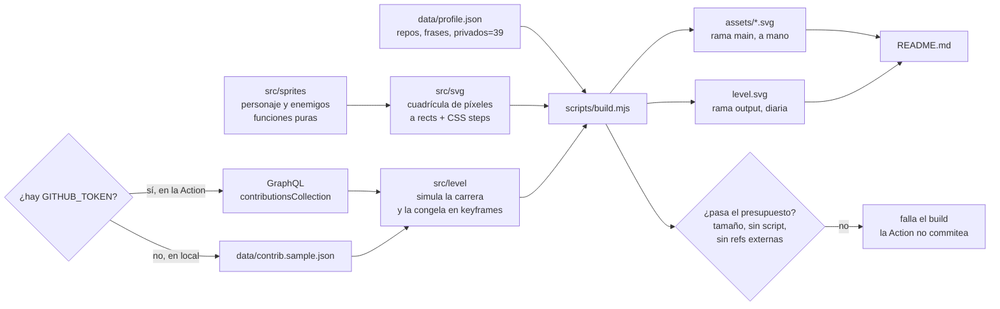

# Perfil de GitHub animado

## Problem

El perfil `github.com/TheSOV` no tiene README. El mockup aprobado
(https://claude.ai/artifact/151ktGtn7zk8BMmr7LZUiJ, versión 7) existe como una
página HTML con canvas y JavaScript, y GitHub no ejecuta JavaScript en un README.
Hay que llevar ese diseño a algo que GitHub sí muestre: imágenes SVG con la
animación dentro, generadas por un script, y un nivel que se regenere solo con
las contribuciones reales.

## Scope

- Repo `TheSOV/TheSOV` (público: GitHub solo muestra el README de perfil si lo es).
- Un generador en Node, **sin dependencias**, que convierte los sprites del mockup
  en SVG animados:
  - cabecera con el personaje en idle (ventiladores girando, LEDs)
  - stage select (una casilla por repo público, enlazada; LOCKED sin enlace)
  - WARNING con frases rotando, SYSTEM STATUS, CROSSOVER, CHIP LOG
  - DEMONIOS INTERNOS: celdas selladas, número de privados **a mano** en
    `data/profile.json` (sin token, decidido 2026-11-01)
  - nivel de contribuciones: el corredor recorre las 52 semanas reales
- Una GitHub Action diaria que regenera **solo el nivel**.
- Un PNG de la cara para la foto de perfil, que la persona sube a mano.
- `README.md` que lo une todo, con texto alternativo real en cada imagen.

## Out of scope

- Datos en vivo de los servidores (temperatura, tok/s): fase posterior, otro plan.
- Contar los repos privados automáticamente (necesitaría un token personal).
- Nombres o contenido de repos privados, en ningún sitio.
- Cualquier cosa clínica o médica.
- Sprites, logos, música o nombres de Capcom: el personaje es original.

## Prior art

| proyecto | qué hace | lo que copiamos | lo que no |
|---|---|---|---|
| [Platane/snk](https://github.com/Platane/snk) | serpiente que se come la gráfica; Action diaria genera SVG | el SVG con animación CSS precalculada; publicar en una rama `output` | su acción de push sobreescribía la rama `output` ([#36](https://github.com/Platane/snk/issues/36)): hacer checkout de esa rama y commitear encima |
| [abozanona/pacman-contribution-graph](https://github.com/abozanona/pacman-contribution-graph) | Pac-Man y fantasmas sobre la gráfica; GraphQL con `GITHUB_TOKEN` | el contrato de datos: GraphQL `contributionsCollection`, ejecución diaria | depender de su paquete npm: nuestro sprite y física son propios |
| [pac-contributions setup](https://pac-contributions.vercel.app/) | guía de uso | el aviso: GitHub cachea los SVG agresivamente | `?v=` como remedio: con una URL fija que cambia a diario no ayuda |

**Veredicto: build.** Nadie hace un personaje de pixel art con física de
plataformas sobre la gráfica; el patrón (Action → SVG con CSS → rama `output`)
está probado y se reutiliza.

**Lo que no está resuelto por nadie y se mide en `#spike`:**

- **Tamaño máximo.** Una fuente no oficial habla de ~50 KB
  ([tessl](https://tessl.io/registry/nitinjain999/platform-skills/1.37.0/files/references/awesome-docs.md)).
  No aparece en la documentación de GitHub, y los SVG de snk suelen pesar más y
  se ven. No se toma como dato: se mide.
- **Rutas relativas.** Sourcegraph documenta casos donde un SVG con ruta relativa
  no se ve ([help](https://help.sourcegraph.com/article/svg-images-not-rendering-in-readme-why-and-workarounds-1xo5qp0luuj2x9lesoa9ko8e)).
  snk usa URL absoluta a la rama `output`. Se prueban las dos.

**La estantería.** *CSS in Depth 2e*, cap. 17, pp. 489-491: `@keyframes` y la
propiedad `animation` definen e interpolan la animación. Lo que necesitamos es
lo contrario: que **no** interpole (cambio de cuadro seco), lo que se consigue con
`steps()`. La estantería no cubre cómo trata GitHub (camo, sanitizador) un SVG;
eso solo lo responde el spike.

## Coupling

Greenfield. Lo que crea:



Si GraphQL falla en la Action, el build termina con error y **no commitea**: el
perfil sigue mostrando el nivel del día anterior.

- «Falla» incluye HTTP 200 con `errors`, o `weeks` con forma inesperada. Un año
  real a cero **no** es fallo: produce un nivel plano.
- Un reintento antes de rendirse.
- `permissions: contents: write` explícito; `concurrency: {group: level,
  cancel-in-progress: false}`.
- La rama `output` se publica como un único commit huérfano con force-push, no
  acumulando historial (evita el problema de snk #36 y que crezca sin fin).
- GitHub desactiva los cron tras 60 días sin actividad en el repo. Se comprueba
  en `#level` si los commits del bot cuentan; si no, `workflow_dispatch` y un
  aviso en el README de cómo reactivarlo.
- Caché: `?v=` no sirve para algo que cambia cada día con la misma URL. El retraso
  de camo que mida `#spike` se acepta.

## Huecos que cambian lo que se construye

Cada tabla trae una recomendación (**★**). Tachar, cambiar o escribir otra en la
fila «otra».

### H1. Dónde viven los SVG generados

| opción | ahora | después |
|---|---|---|
| **★ estáticos en `main`, nivel en rama `output`** | dos sitios | historial de `main` limpio; el nivel cambia cada día sin ensuciarlo |
| todo en `main` | un sitio | 365 commits al año de la Action en `main` |
| otra | | |

### H2. De dónde salen las contribuciones

| opción | ahora | después |
|---|---|---|
| **★ GraphQL con el `GITHUB_TOKEN` automático de la Action** | nada que crear: no es un token tuyo, GitHub lo da a cada ejecución | cuenta las públicas seguro; si incluye las privadas (con «Include private contributions» activado) es memoria, no dato: lo comprueba `#spike` contra el total que muestra tu perfil |
| scraping de la página de contribuciones | sin API | se rompe cuando GitHub cambia su HTML |
| otra | | |

### H3. Modo claro

| opción | ahora | después |
|---|---|---|
| **★ solo oscuro, cada SVG trae su fondo** | un diseño | en tema claro se ven como paneles oscuros, como el mockup |
| claro y oscuro con `<picture>` | doble paleta | doble mantenimiento de cada sprite |
| otra | | |

### H4. Movimiento reducido

| opción | ahora | después |
|---|---|---|
| **★ `@media (prefers-reduced-motion)` dentro de cada SVG: se para en un cuadro** | unas líneas | quien lo pida ve una imagen fija, **si** el navegador lo respeta dentro de un ``: lo mide `#spike` |
| ignorarlo | nada | — |
| otra | | |

### H5. Duración del bucle del nivel

| opción | ahora | después |
|---|---|---|
| **★ ~30 s para las 52 semanas, y vuelta a empezar** | — | más segundos = más keyframes = más peso; el spike dice el presupuesto |
| ~60 s, más lento | | el doble de keyframes |
| otra | | |

### H6. Texto en los SVG

| opción | ahora | después |
|---|---|---|
| **★ fuente pixel propia dibujada como rects** (como los sprites) | una tabla de glifos | se ve igual en todos los navegadores; sin fuentes externas, que camo bloquea |
| `<text>` con fuente del sistema | trivial | cada sistema la pinta distinta y se pierde el aire retro |
| otra | | |

## Related

Mockup: https://claude.ai/artifact/151ktGtn7zk8BMmr7LZUiJ (v7).

## Open questions

- Presupuesto real de tamaño de un SVG en un README: lo fija `#spike`, y `#level`
  espera por él.
- Si el nivel no cabe en el presupuesto aun comprimido, la alternativa es GIF
  generado en la Action. No se decide hasta medir.

## Decisiones por el camino

- 2026-11-01 · ¿Token para contar privados? → no, el número se cambia a mano de cuando en cuando (persona)
- 2026-11-01 · ¿Cómo se llaman los privados en el perfil? → «demonios internos», sin nombres (persona)
- 2026-11-01 · ¿Un plan o dos encadenados? → un plan, con la prueba en GitHub como primer hito (persona)
- 2026-11-01 · ¿Modo plan o libre? → plan (persona)
- 2026-11-01 · Medidores de SYSTEM STATUS → añadir RAM: 128 GB por servidor, 256 GB en total (persona; corregido el mismo día, primero lo entendí como 256 + 128)
- 2026-11-01 · ¿Plan y huecos H1-H6 con sus ★? → aprobado (persona)
- 2026-11-01 · ¿Borrar el repo temporal TheSOV/svg-probe al cerrar #spike? → sí, borrado por la persona; los resultados quedan en `spike/README.md` (persona)
- 2026-11-01 · Presupuesto de peso por SVG → 1 000 000 bytes, bajo los 1 070 982 que el spike vio animar en todos los navegadores; no se conoce el límite real (agente)
- 2026-11-01 · Rects fusionados por filas → se emiten como un `<path>` por color (`M x y h w v1 h-w z`), ~12 bytes por tramo en vez de ~55 con `<rect>` (agente)
- 2026-11-01 · ¿Mostrar colaboraciones con otros? → sí, panel «ALIADOS · CO-OP» a mano en `data/profile.json`: jztan/pdf-mcp, Panchovix/nvidia-linux-vbios-vix-loader, y «2 alianzas selladas» por las orgs de pertenencia privada, sin nombrarlas (persona, opción A)
- 2026-11-01 · Color del corte de la cabecera → el mismo de la hoja térmica del héroe (`#ff9a3d` con núcleo `#fff2d6`), no el verde sable; mockup actualizado a v10 (persona)
- 2026-11-01 · Etiquetas de SYSTEM STATUS → partidas en dos líneas a escala 2 en vez de encogerse a escala 1, que no se leía (agente)

## Milestones

- [x] **Un SVG animado de prueba se ve moviéndose en un README real de GitHub**, y queda escrito qué tamaño y qué rutas aguanta #spike

      Registra, en una tabla en spike/README.md:
        - pesos 50 / 150 / 400 / 1000 KB, con tantos rects × keyframes como el
          peor caso del nivel
        - ruta relativa vs raw.githubusercontent vs rama `output`
        - anima o no en Chrome, Firefox, Safari y la app móvil de GitHub
        - si `prefers-reduced-motion` se respeta dentro de un ``
        - `Cache-Control` de camo y cuánto tarda un push en verse
        - un GIF grande como alternativa: ¿anima?
        - si el total del perfil con `GITHUB_TOKEN` incluye las privadas
        - el sha del commit de la prueba

      touches:
        - spike/README.md
        - spike/.gitignore
        - spike/gen.mjs

- [x] **Los sprites se dibujan sin canvas**: funciones puras que devuelven una cuadrícula de colores, idénticas píxel a píxel a la salida de `makeSprite` en el mockup #sprite

      Lo que el mockup dibuja fuera de la cuadrícula se rediseña en pixel art:
      el arco del corte (`arc`), las estelas con `globalAlpha`, los destellos
      rgba y los textos en VT323 (pasan a la fuente de rects de H6).

      touches:
        - src/sprites/raster.mjs
        - src/sprites/hero.mjs
        - src/sprites/enemies.mjs
        - test/sprites.test.mjs

- [x] **Una cuadrícula se convierte en SVG** con rects fusionados por filas y cuadros animados con `steps()`, y el validador rechaza script, refs externas y exceso de peso #svg needs #sprite

      touches:
        - src/svg/grid.mjs
        - src/svg/frames.mjs
        - src/svg/font.mjs
        - src/svg/check.mjs
        - test/svg.test.mjs

- [x] **Los SVG fijos existen y se ven como el mockup**: cabecera, stage select, warning, status, crossover, chip log, demonios, aliados, y el PNG de la cara #static needs #svg

      touches:
        - data/profile.json
        - src/panels.mjs
        - scripts/build.mjs
        - assets/header.svg
        - assets/stages.svg
        - assets/warning.svg
        - assets/status.svg
        - assets/crossover.svg
        - assets/chiplog.svg
        - assets/demons.svg
        - assets/allies.svg
        - assets/face.png

- [ ] **El nivel sale de contribuciones reales** y una Action diaria lo publica en la rama `output`; si falla, no commitea #level needs #svg #spike

      touches:
        - src/level/simulate.mjs
        - src/level/render.mjs
        - src/contrib.mjs
        - data/contrib.sample.json
        - .github/workflows/level.yml
        - test/level.test.mjs

- [ ] **El README une todo** con texto alternativo en cada imagen, y el perfil publicado se ve como el mockup #readme needs #static #level

      touches:
        - README.md

## Verification

```sh
node --test && node scripts/build.mjs --sample && node src/svg/check.mjs assets out/level.svg
# tests: 0 fail · check: "N svg ok, 0 over budget, 0 forbidden, 0 without keyframes"
```

Qué afirman los tests, porque un SVG válido y pequeño puede estar roto:

- **Sprites**: el sha256 de cada cuadrícula de `makeSprite` coincide con un golden
  capturado del mockup (un `ctx` falso que registra `fillRect`). Solo los sprites:
  los efectos del nivel se rediseñan (ver `#sprite`).
- **Nivel**: las 52 columnas están; el corredor nunca queda por debajo del
  terreno en ningún keyframe; un año a cero produce un nivel plano válido, no un
  error; datos con forma incorrecta sí son error.
- **check.mjs**: cada SVG animado tiene al menos un `@keyframes` y un `steps(`;
  ninguno tiene `<script>`, `on*=`, `href` externo, `@import` ni `url(` remota; el
  peso está bajo el presupuesto que fije `#spike`.

Lo remoto, como traza y no como «se ve» (fila de `## Simulacion` al cerrar):

- el HTML de `github.com/TheSOV` contiene cada imagen; la URL de camo devuelve
  `content-type: image/svg+xml` y un sha256 igual al del archivo publicado;
- dos capturas headless del perfil separadas 1 s son distintas en la zona de cada
  SVG animado;
- el historial de la rama `output` muestra al menos una ejecución programada (no
  manual) de la Action.
