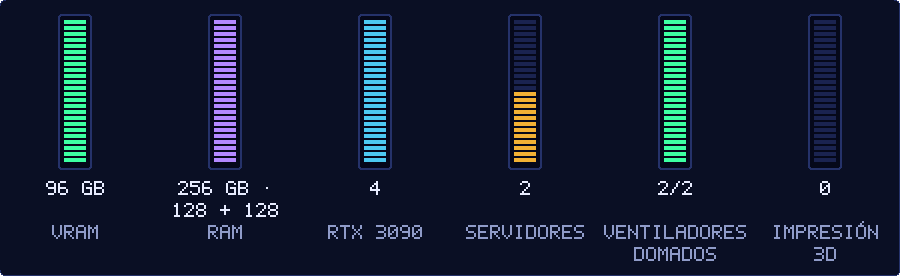
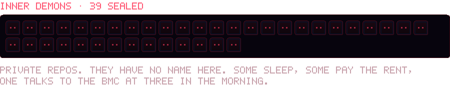

<!--
  Generated images: `node scripts/build.mjs` writes assets/, `node src/level/render.mjs` the level.
  The level is rebuilt daily by .github/workflows/level.yml and published on the `output` branch.
  If GitHub disables the schedule after 60 days without activity in this repo, re-enable it in
  Actions > level > "Enable workflow", or run it by hand with "Run workflow".
-->

  

  

  <b>GPU FORGE</b> <a href="https://github.com/TheSOV/mc62-g40-quad-3090">mc62-g40-quad-3090</a> ·
  <b>LEGACY IRON</b> <a href="https://github.com/TheSOV/h11ssl-quiet-fans">h11ssl-quiet-fans</a> ·
  <b>INFERENCE</b> <a href="https://github.com/TheSOV/quad-3090-llm-bench">quad-3090-llm-bench</a>, <a href="https://github.com/TheSOV/pdf-mcp">pdf-mcp</a> ·
  <b>AGENTS</b> <a href="https://github.com/TheSOV/KubernetesCrew">KubernetesCrew</a>, <a href="https://github.com/TheSOV/NLP_Fact_checker">NLP_Fact_checker</a>, <a href="https://github.com/TheSOV/TwilioVoiceBot">TwilioVoiceBot</a>

  

  

  

  

  

  

  

  <a href="https://github.com/jztan/pdf-mcp">jztan/pdf-mcp</a> ·
  <a href="https://github.com/Panchovix/nvidia-linux-vbios-vix-loader">Panchovix/nvidia-linux-vbios-vix-loader</a>

