<!--
  Generated images: `node scripts/build.mjs` writes assets/, `node src/level/render.mjs` the level.
  The level is rebuilt daily by .github/workflows/level.yml and published on the `output` branch.
  If GitHub disables the schedule after 60 days without activity in this repo, re-enable it in
  Actions > level > "Enable workflow", or run it by hand with "Run workflow".
-->

  

<!-- stage-select:start (generated by scripts/build.mjs from data/profile.json) -->

<table align="center">
<tr>
  <td width="33%" valign="top">

<picture></picture>
 <b>ZONA</b> Un Gigabyte MC62-G40 con cuatro 3090 blower para inferencia. Arreglo del pico de ventiladores del BMC y mínimo de ventilador en la VBIOS.  <b>JEFE</b> CUATRO TURBINAS A FONDO  <b>REPOS</b> <a href="https://github.com/TheSOV/mc62-g40-quad-3090">mc62-g40-quad-3090</a>
</td>
  <td width="33%" valign="top">

<picture></picture>
 <b>ZONA</b> Supermicro H11SSL-i con EPYC, silenciado desde Windows sin instalar nada: IPMI en crudo por WMI y registros del SDR borrados y restaurados.  <b>JEFE</b> FAIL-SAFE DE BAJAS RPM  <b>REPOS</b> <a href="https://github.com/TheSOV/h11ssl-quiet-fans">h11ssl-quiet-fans</a>
</td>
  <td width="33%" valign="top">

<picture></picture>
 <b>ZONA</b> El MC62 como servidor de inferencia, medido con vLLM sin P2P ni NVLink, y herramientas para que los agentes lean PDFs enormes sin desbordar el contexto.  <b>JEFE</b> CONTEXTO DESBORDADO  <b>REPOS</b> <a href="https://github.com/TheSOV/mc62-g40-quad-3090">mc62-g40-quad-3090</a> <a href="https://github.com/TheSOV/quad-3090-llm-bench">quad-3090-llm-bench</a> <a href="https://github.com/TheSOV/pdf-mcp">pdf-mcp</a>
</td>
</tr>
<tr>
  <td width="33%" valign="top">

<picture></picture>
 <b>ZONA</b> Sistemas multiagente: manifiestos de Kubernetes a partir de lenguaje natural, verificación de afirmaciones contra Wikipedia y llamadas de voz en tiempo real.  <b>JEFE</b> ALUCINACIONES  <b>REPOS</b> <a href="https://github.com/TheSOV/KubernetesCrew">KubernetesCrew</a> <a href="https://github.com/TheSOV/NLP_Fact_checker">NLP_Fact_checker</a> <a href="https://github.com/TheSOV/TwilioVoiceBot">TwilioVoiceBot</a>
</td>
  <td width="33%" align="center"><picture></picture></td>
  <td width="33%" valign="top">

<picture></picture>
 <b>ZONA</b> Sensores, shunts y firmware para medir y controlar el resto del hardware.  <b>JEFE</b> ???  <b>REPOS</b> <i>Todavía no hay ninguno. Este stage se desbloquea con el primer repo.</i>
</td>
</tr>
<tr>
  <td width="33%" valign="top">

<picture></picture>
 <b>ZONA</b> Impresión 3D funcional: ductos para las 3090, soportes, cajas para la electrónica.  <b>JEFE</b> ???  <b>REPOS</b> <i>Todavía no hay ninguno. Este stage se desbloquea con el primer repo.</i>
</td>
  <td width="33%" valign="top">

<picture></picture>
 <b>ZONA</b> Fine-tuning en las 3090: LoRA, datasets propios y evaluación.  <b>JEFE</b> ???  <b>REPOS</b> <i>Todavía no hay ninguno. Este stage se desbloquea con el primer repo.</i>
</td>
  <td width="33%" valign="top">

<picture></picture>
 <b>ZONA</b> Donde ya se cruzan los stages: firmware, BMC y scripts que domestican hardware de servidor.  <b>JEFE</b> EL RUIDO  <b>REPOS</b> <a href="https://github.com/TheSOV/h11ssl-quiet-fans">h11ssl-quiet-fans</a> <a href="https://github.com/TheSOV/mc62-g40-quad-3090">mc62-g40-quad-3090</a>
</td>
</tr>
</table>
<!-- stage-select:end -->

  

  

  

  

  

  

  

  <a href="https://github.com/jztan/pdf-mcp">jztan/pdf-mcp</a> ·
  <a href="https://github.com/Panchovix/nvidia-linux-vbios-vix-loader">Panchovix/nvidia-linux-vbios-vix-loader</a>

