<!-- Generated by scripts/build.mjs from data/profile.json. -->

<h3>ZONA</h3>

Donde ya se cruzan los stages: firmware, BMC y scripts que domestican hardware de servidor.

<h3>JEFE</h3>

<b>EL RUIDO</b>

<h3>REPOS</h3>
<ul><li><a href="https://github.com/TheSOV/h11ssl-quiet-fans">h11ssl-quiet-fans</a></li><li><a href="https://github.com/TheSOV/mc62-g40-quad-3090">mc62-g40-quad-3090</a></li></ul>

<a href="https://github.com/TheSOV">◂ VOLVER AL STAGE SELECT</a>

