<!-- Generated by scripts/build.mjs from data/profile.json. -->

<h3>ZONE</h3>

A Gigabyte MC62-G40 with four blower 3090s for inference. A fix for the BMC's fan spikes, and a fan floor in the VBIOS.

<h3>BOSS</h3>

<b>FOUR TURBINES AT FULL TILT</b>

<h3>REPOS</h3>
<ul><li><a href="https://github.com/TheSOV/mc62-g40-quad-3090">mc62-g40-quad-3090</a></li></ul>

<a href="https://github.com/TheSOV">◂ BACK TO STAGE SELECT</a>

