<!-- Generated by scripts/build.mjs from data/profile.json. -->

<h3>ZONA</h3>

El MC62 como servidor de inferencia, medido con vLLM sin P2P ni NVLink, y herramientas para que los agentes lean PDFs enormes sin desbordar el contexto.

<h3>JEFE</h3>

<b>CONTEXTO DESBORDADO</b>

<h3>REPOS</h3>
<ul><li><a href="https://github.com/TheSOV/mc62-g40-quad-3090">mc62-g40-quad-3090</a></li><li><a href="https://github.com/TheSOV/quad-3090-llm-bench">quad-3090-llm-bench</a></li><li><a href="https://github.com/TheSOV/pdf-mcp">pdf-mcp</a></li></ul>

<a href="https://github.com/TheSOV">◂ VOLVER AL STAGE SELECT</a>

