<!-- Generated by scripts/build.mjs from data/profile.json. -->

<h3>ZONA</h3>

Supermicro H11SSL-i con EPYC, silenciado desde Windows sin instalar nada: IPMI en crudo por WMI y registros del SDR borrados y restaurados.

<h3>JEFE</h3>

<b>FAIL-SAFE DE BAJAS RPM</b>

<h3>REPOS</h3>
<ul><li><a href="https://github.com/TheSOV/h11ssl-quiet-fans">h11ssl-quiet-fans</a></li></ul>

<a href="https://github.com/TheSOV">◂ VOLVER AL STAGE SELECT</a>

